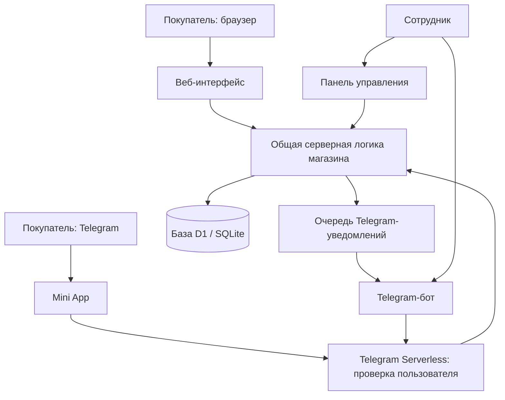

# Курсовая работа

**Лицей РАНХиГС**

**Курс:** «Нейросети для жизни и учёбы»

**Тема:** «Создание интернет-магазина с Telegram-ботом с помощью нейросетей»

**Проект:** UNICA & FLOWERS

**Выполнил:** Писенко Михаил

**Класс:** 11-3

**Год:** 2026

## Содержание

1. [Введение](#1-введение)
2. [Идея проекта и требования](#2-идея-проекта-и-требования)
3. [Использование нейросетей](#3-использование-нейросетей)
4. [Устройство и реализация системы](#4-устройство-и-реализация-системы)
5. [Проверка результата](#5-проверка-результата)
6. [План получения дохода](#6-план-получения-дохода)
7. [Заключение](#7-заключение)
8. [Материалы проекта](#8-материалы-проекта)

## 1. Введение

Небольшому магазину необходимо показывать ассортимент, принимать заявки и отвечать покупателям. Если эти действия выполняются только в личных сообщениях, сведения о товарах и заказах оказываются в разных переписках. Покупателю приходится отдельно уточнять характеристики каждого товара, а продавцу — вручную собирать состав заявки и следить за её состоянием.

В качестве практического проекта выбран магазин гортензий UNICA & FLOWERS. Разработанное решение объединяет каталог, оформление заявки, панель сотрудников и общение через Telegram. Покупатель может открыть магазин в браузере или внутри Telegram.

**Цель работы** — создать с помощью нейросетей работающий проект для реального применения и получить доход от его разработки или дальнейшего сопровождения.

Для достижения цели поставлены следующие задачи:

1. Выбрать задачу, полезную потенциальному заказчику.
2. Сформулировать требования к магазину и распределить права пользователей.
3. Использовать нейросеть для подготовки интерфейса, программной логики и проверок.
4. Объединить сайт, базу данных и Telegram-бота.
5. Проверить основные сценарии и исправить обнаруженные ошибки.
6. Подготовить исходный код, инструкции и демонстрацию результата.
7. Определить, за какие работы заказчик может платить.

**Объект работы** — процесс выбора товаров и обработки заявок небольшого цветочного магазина.

**Предмет работы** — создание веб-приложения и Telegram-бота с использованием нейросети как помощника разработчика.

Практическая ценность проекта заключается в готовом инструменте для приёма и обработки заявок. Учебная ценность — в освоении постановки задач нейросети, проверки полученных решений и доведения прототипа до работающего приложения.

## 2. Идея проекта и требования

### 2.1. Пользователи

В системе выделены три роли.

| Роль | Основные действия |
| --- | --- |
| Покупатель | Изучает ассортимент, сравнивает сорта, оформляет заявку, просматривает её состояние и пишет магазину |
| Администратор | Редактирует каталог, обрабатывает заявки и отвечает покупателям |
| Владелец | Управляет магазином и доступом сотрудников |

Покупка начинается с выбора сорта. У товара есть фотография, описание и характеристики. Покупатель добавляет позиции в корзину, указывает количество и сведения для связи, затем отправляет заявку. Сотрудник видит её в панели и получает уведомление в Telegram.

### 2.2. Функциональные требования

В покупательской части предусмотрены каталог, поиск по названиям, фильтрация, сортировка и сравнение до трёх сортов. Корзина сохраняет выбранные позиции на устройстве. При оформлении проверяются состав заявки и обязательные поля.

После сохранения покупатель может посмотреть историю и статус заказа, написать сообщение, повторить выбор или отменить новую заявку. Для доступа с другого устройства предусмотрена личная ссылка или код восстановления.

Панель сотрудников содержит активные заказы, архив, каталог, настройки и журнал действий. Владелец может управлять сотрудниками. Telegram-бот открывает магазин, принимает обращения и предоставляет сотрудникам действия с заказами.

### 2.3. Требования к качеству

Интерфейс должен работать на компьютере и телефоне, поддерживать клавиатуру и понятные подписи элементов. Анимации учитывают системную настройку уменьшения движения.

Сервер должен проверять данные независимо от интерфейса. Покупатель получает доступ только к своим заказам, а административные операции требуют подтверждённых прав. Повторная отправка одной заявки не должна создавать второй заказ.

В проекте оформляется заявка на покупку. Итоговые условия подтверждает продавец. Автоматическая оплата, тарификация доставки и резервирование фактических остатков не входят в реализованный объём.

Полное техническое задание находится в [BRIEF.md](../sites/unika-flowers/BRIEF.md).

## 3. Использование нейросетей

### 3.1. Роль нейросети в работе

Нейросеть используется как помощник на этапах постановки задачи, разработки и оформления результата. В процессе работы с проектом используются ChatGPT/Codex: обсуждение требований, создание и изменение файлов, анализ кода, запуск проверок и подготовка документации.

| Этап | Задача для нейросети | Способ проверки |
| --- | --- | --- |
| Постановка задачи | Преобразовать идею магазина в перечень функций | Сопоставить с задачами покупателя и продавца |
| Интерфейс | Подготовить страницы каталога и формы | Открыть приложение и пройти сценарии |
| Сервер | Реализовать сохранение заказов, роли и сообщения | Прочитать логику, запустить тесты |
| Исправления | Найти причину ошибки и предложить изменение | Воспроизвести проблему и проверить результат |
| Документация | Описать установку, устройство и результаты | Сверить текст с файлами проекта |

Для работы полезно задавать конкретную цель, описывать ограничения и указывать критерий готовности. Например, запрос «сделай магазин» оставляет много неоднозначностей. Более точное задание определяет ассортимент, действия покупателя, состав заявки, роли сотрудников и порядок проверки.

### 3.2. Проверка ответов

Полученный от нейросети код требует проверки. Файл может выглядеть убедительно, но содержать ошибку в обработке повторного запроса, выдаче прав или переходе статуса.

Поэтому используется цикл:

1. Сформулировать небольшую задачу и ожидаемый результат.
2. Получить и изучить предложенные изменения.
3. Запустить соответствующие проверки.
4. Проверить пользовательский сценарий.
5. Исправить замечания и сохранить работоспособный результат.

Нейросеть помогает ускорить подготовку решений, однако сама по себе скорость генерации не доказывает качество продукта. Для заказчика важны работающие функции и возможность поддерживать систему после передачи.

### 3.3. Обращение с данными

Рабочие API-ключи, пароли, настройки доступа и базы покупателей исключены из репозитория. Проверки используют тестовые данные. Перед первой загрузкой актуальных исходников выполнен поиск известных локальных учётных данных и характерных форматов ключей.

Публикация выполнена новой историей Git, без переноса истории прежних рабочих папок. В результате материалы курсовой можно просматривать отдельно от настроек действующего магазина.

## 4. Устройство и реализация системы

### 4.1. Общая схема

Система состоит из интерфейса покупателя, общей серверной части, базы данных и Telegram-модуля.



Обычный браузер обращается к HTTP API магазина. В Telegram запрос проходит через обработчик, который получает подтверждённые платформой сведения о пользователе. Новые заявки из обоих каналов обрабатывает общая серверная логика.

Telegram-модуль сохраняет также обработчики существующих заказов самого бота. Их поддержка входит в текущую реализацию; прежний веб-интерфейс в материалы курсовой не включён.

### 4.2. Выбранные технологии

| Технология | Применение |
| --- | --- |
| HTML, CSS, JavaScript | Интерфейс каталога, корзины и управления |
| Telegram Web App SDK | Работа интерфейса внутри Telegram |
| JavaScript и Node.js | Серверная логика, локальный запуск, инструменты и тесты |
| Next.js | Маршрут HTTP API в облачном приложении |
| SQLite / Cloudflare D1 | Локальное и облачное хранение данных |
| Drizzle ORM | Описание таблиц и SQL-миграции |
| Telegram Serverless | Обработчики сообщений, кнопок и запросов Mini App |
| Git и GitHub | Хранение исходников и документации |

Клиентская часть каталога находится в `sites/unika-flowers/public/`. Серверная логика размещена в `server/`. В Telegram-проекте папка `tgcloud/` содержит обработчики, а `web/` — актуальную статику Mini App.

### 4.3. База данных

Основные сущности общей базы:

| Таблица | Назначение |
| --- | --- |
| `products` | Товары, их данные и версии изменений |
| `orders` | Заявки, контакты, статусы и сведения для поиска |
| `order_access` | Доступ устройства к конкретному заказу |
| `messages` | Переписка по заказу |
| `staff` | Учётные записи и роли сотрудников |
| `sessions` | Сеансы сотрудников |
| `settings` | Настройки магазина |
| `audit` | Журнал административных действий |
| `rate_limits` | Ограничения частоты запросов |
| `telegram_outbox` | Уведомления и состояние их доставки |
| `telegram_links` | Связь сообщения Telegram с заказом |

Заказ связан с сообщениями и записями доступа по идентификатору. Сеанс связан с сотрудником. Сообщение Telegram сопоставляется заказу по паре идентификаторов чата и сообщения. Поля версий помогают выявлять одновременные изменения.

Схема находится в [db/schema.ts](../sites/unika-flowers/db/schema.ts), миграции — в [drizzle/](../sites/unika-flowers/drizzle/). Часть характеристик товара и состава заявки хранится в JSON-полях. Это упрощает сохранение составных данных; согласованность их структуры проверяется программной логикой.

### 4.4. Оформление и обработка заявки

При отправке формы сервер проверяет идентификаторы товаров, количество, доступность и контактные сведения. Цена определяется сервером, поэтому изменение формы в браузере не должно менять стоимость товара.

Каждый запрос на оформление имеет ключ. Повтор запроса с тем же ключом возвращает уже созданный результат. Такой подход защищает от дублей при двойном нажатии и повторе после задержки ответа.

Основная последовательность статусов: новый, подтверждённый, собирается, готов к получению, завершённый. Предусмотрена отмена. Выполненные и отменённые заявки отображаются в архиве. При одновременной работе сотрудников проверяется версия записи, чтобы не перезаписать более новое изменение.

### 4.5. Переписка и уведомления

Сообщения покупателя сохраняются по заказу. Сотрудник может ответить через сайт или поддерживаемый сценарий Telegram-бота. Ответ из Telegram сопоставляется нужному заказу и появляется в его переписке.

Уведомления сохраняются в очереди отдельно для получателей. Успешная доставка одному сотруднику не означает успешную доставку другому. При ошибке запись остаётся для повторной попытки.

Повторная обработка очереди выполняется при последующих обращениях к системе. Фоновый планировщик для гарантированной отправки по времени в текущей версии не настроен.

### 4.6. Разграничение доступа

Права проверяются на сервере. В браузере сотрудники входят в учётную запись; для паролей используется PBKDF2-SHA-256 с индивидуальной солью. В базе сохраняются хеши сеансов, а не их исходные значения.

Для Telegram используются сведения, подтверждённые серверным окружением платформы. Введённый пользователем идентификатор или параметры URL не предоставляют административных прав.

Личные ссылки восстановления заказа содержат случайный код, в базе хранится его хеш. Это позволяет отделить номер заявки от права доступа к её содержимому.

## 5. Проверка результата

### 5.1. Автоматизированные тесты

На 21 октября 2026 года в подготовленной версии успешно выполнены 59 тестов.

| Набор | Количество | Область проверки |
| --- | --- | --- |
| Сервер сайта | 20 | Каталог, заказы, доступ, сотрудники, сообщения, HTTP и общий режим Telegram |
| Telegram-уведомления общей базы | 5 | Доставка, повторы, ответы и действия со статусами |
| Telegram-модуль | 34 | Обработчики, роли, данные, заказы, сообщения и соединение с сайтом |
| **Итого** | **59** | **Все выполненные тесты прошли** |

Для сервера применяется SQLite в памяти. Для обработчиков бота используется тестовое окружение SDK и запись отправляемых сообщений в память. Проверки не создают рабочие заказы и не отправляют сообщения реальным покупателям.

Тесты подтверждают проверенные сценарии. Замер нагрузки, отдельный аудит безопасности и исследование удобства на группе пользователей в эти результаты не входят.

### 5.2. Запуск проверок

Из корня репозитория:

```powershell
cd sites/unika-flowers
node --test scripts/shop.test.mjs scripts/telegram.test.mjs

cd ../../UNIKAFLOWERS_V2
node --experimental-vm-modules --test scripts/*.test.mjs
```

### 5.3. Сценарий демонстрации

Для защиты работы можно использовать локальный магазин:

```powershell
cd sites/unika-flowers
node scripts/local-server.mjs
```

После запуска открыть [http://localhost:4180/](http://localhost:4180/).

Последовательность показа:

1. Найти сорт по названию и применить фильтр.
2. Открыть карточку товара и сравнить несколько сортов.
3. Добавить позиции в корзину и оформить тестовую заявку.
4. Показать её статус и переписку покупателя.
5. Войти сотрудником, найти заявку и изменить статус.
6. Отправить ответ и показать его в интерфейсе покупателя.
7. Показать результаты тестов и соответствующие папки исходного кода.

Данные первого локального входа находятся в `.local/access.txt`. Локальная база отделена от рабочего магазина. Telegram-уведомления демонстрируются отдельно в настроенном облачном окружении или через результаты изолированных тестов.

## 6. План получения дохода

### 6.1. Предложение заказчику

Коммерческое предложение проекта — разработка и настройка небольшого интернет-магазина с Telegram-ботом. Заказчику передаётся инструмент, в котором ассортимент, заявки и переписка связаны между собой.

Вместо продажи только набора файлов можно предложить законченный объём работ: заполнение каталога, настройку ролей, подключение бота, демонстрацию и инструкцию для сотрудников.

### 6.2. Возможные источники дохода

| Услуга | Состав работ |
| --- | --- |
| Разработка и запуск | Интерфейс, каталог, заявки, бот, развёртывание и обучение |
| Сопровождение | Обновление товаров, проверка работы, исправление ошибок |
| Дополнительные функции | Новые разделы, экспорт, отчёты и интеграции по отдельному заданию |

План получения первой оплаты состоит из подготовки демонстрации, согласования нужных функций с заказчиком, определения стоимости и передачи проверенного результата. Изменения после согласованного объёма следует оценивать отдельно.

### 6.3. Расчёт результата

Для оценки можно использовать выражение:

**Доход от проекта = оплата разработки + оплата сопровождения − прямые расходы.**

К прямым расходам относятся оплаченные инструменты разработки, хостинг, домен и другие ресурсы, если они используются. Для оценки выгоды также нужно учитывать собственное время: уточнение требований, проверку кода, исправления и общение с заказчиком.

Суммы оплаты и расходов в исходных данных работы не указаны. Поэтому финансовая часть описывает план монетизации; факт получения дохода должен подтверждаться отдельно после реальной оплаты.

### 6.4. Дальнейшее развитие

Следующими этапами могут стать подключение оплаты, учёт реальных остатков, расчёт доставки и фоновая обработка уведомлений. Выбирать их следует по потребностям заказчика и готовности оплачивать разработку и поддержку.

## 7. Заключение

В практической части создан магазин UNICA & FLOWERS с веб-интерфейсом, общей серверной логикой, базой данных и Telegram-ботом. Реализованы каталог, корзина, заявки, переписка и обработка заказов сотрудниками. Для подготовленной версии успешно выполнены 59 автоматизированных тестов.

Работа показывает применение нейросетей для создания программного проекта: от уточнения идеи до подготовки кода, проверок и документации. Полезный результат достигается при последовательной постановке задач и проверке ответов.

Техническая часть цели выполнена: подготовлен работающий проект, который можно демонстрировать потенциальному заказчику. Коммерческая часть представлена планом продажи разработки и сопровождения; получение оплаты является следующим измеримым результатом.

## 8. Материалы проекта

Пояснительная записка основана на исходном коде и проверках этого репозитория.

1. [Техническое задание](../sites/unika-flowers/BRIEF.md).
2. [Инструкция по запуску веб-приложения](../sites/unika-flowers/README.md).
3. [Описание Telegram-модуля](../UNIKAFLOWERS_V2/README.md).
4. [Серверная логика магазина](../sites/unika-flowers/server/shop.mjs).
5. [Схема общей базы данных](../sites/unika-flowers/db/schema.ts).
6. [Логика Telegram-уведомлений](../sites/unika-flowers/server/telegram.mjs).
7. [Проверки сервера](../sites/unika-flowers/scripts/shop.test.mjs).
8. [Проверки доставки и ответов](../sites/unika-flowers/scripts/telegram.test.mjs).
9. [Соединение Mini App с сервером](../UNIKAFLOWERS_V2/tgcloud/endpoints/siteBridge.js).
